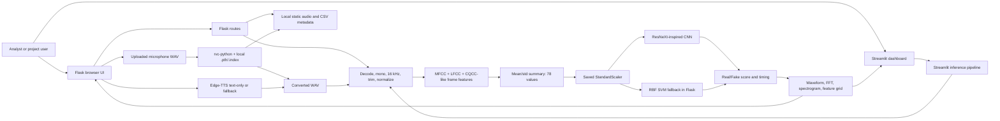
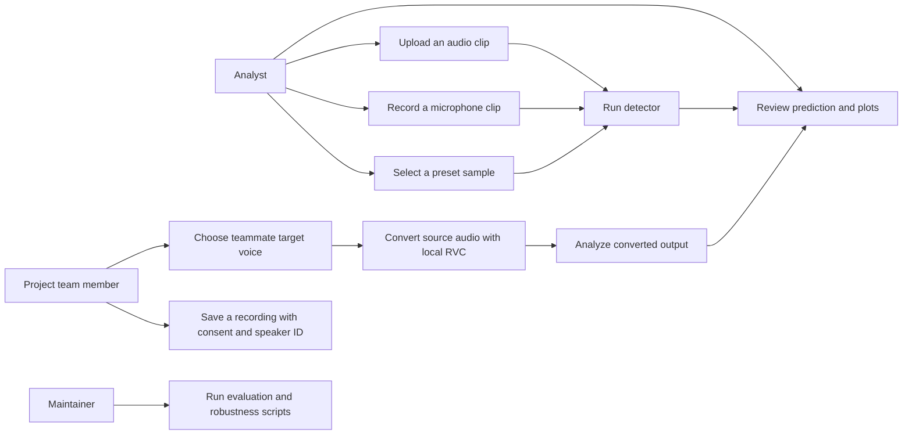
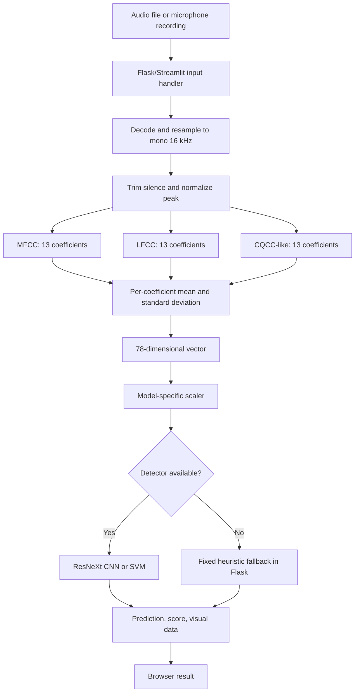
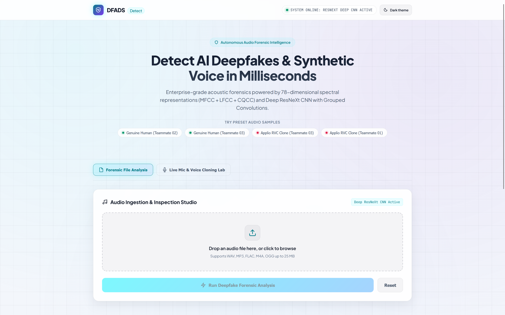

# Audio Deepfake Detection System Project Documentation

**Project name:** Audio Deepfake Detection System (DFADS)  
**Primary application:** Audio authenticity classification with an optional voice-conversion laboratory  
**Implementation:** Python, Flask, Streamlit, librosa, scikit-learn, TensorFlow/Keras, PyTorch, and `rvc-python`

This document follows the chapter hierarchy in the supplied reference contents while replacing its rural-service subject matter with DFADS implementation details. It separates implemented behavior from project plans and from evaluation artifacts that represent different experiments. Page numbers from the reference are omitted because Markdown pages are not fixed.

## Project Summary

DFADS accepts speech audio and classifies it as **Real** or **Fake**. Its feature pipeline combines statistics from MFCC, LFCC, and a CQCC-like representation into 78 values. A small ResNeXt-inspired CNN is the preferred detector when its weights load; the Flask application also contains an SVM fallback. The repository provides a browser-based Flask application, a separate Streamlit dashboard, local RVC v2 voice-conversion models, evaluation scripts, and saved datasets and results.

The source code implements file upload, microphone recording, detection, audio visualizations, optional RVC conversion, Edge-TTS synthesis, and local CSV/file persistence. It does **not** implement a database, user authentication, bilingual localization, a progressive web application, offline synchronization, or a document-retrieval/RAG pipeline. These topics appear in the reference contents and are addressed below as absent or future work.

### Key Repository Facts

| Area | Verified project state |
|---|---|
| Feature table | `data/features/features.csv`: 35,740 rows, 78 feature columns and a label column; labels are balanced (17,870 per class). |
| Saved feature test split | `data/features/test_split.csv`: 7,148 rows, balanced 3,574 / 3,574. |
| Human and generated audio metadata | `data/metadata.csv`: 199 entries (154 genuine, 30 RVC-generated, 15 XTTS-generated), with speaker and split fields. |
| Detection | RBF SVM and ResNeXt-inspired Keras CNN artifacts are present. |
| Voice conversion | Five teammate `.pth` models and five matching `.index` files are present under `models/rvc_voices/`. |
| Web service | Flask binds to `0.0.0.0:5000` when launched; locally it is normally opened at `http://localhost:5000`. |
| Persistence | Audio, models, feature CSV/NPY files, and results are stored in local project directories; no SQL database is defined. |

## CHAPTER 1: INTRODUCTION

### 1.1 Background and Project Overview

Text-to-speech and voice-conversion systems can generate speech that resembles a human speaker. DFADS explores acoustic classification as a way to flag audio that may be synthetic. It is a research and demonstration project: predictions are model outputs for review, not proof of identity, provenance, or intent.

The batch pipeline standardizes audio, extracts three cepstral feature families, trains classical baselines and a compact grouped-convolution CNN, and evaluates saved checkpoints. The application accepts an audio file or microphone recording, returns a binary prediction and model score, and displays waveform, spectrum, spectrogram, and feature information. The Flask microphone workflow can also convert a source recording into one of five teammate voices using local RVC models. A text-only request uses Edge-TTS instead.

Two interfaces are present:

1. **Flask interface:** `app/app.py` with the Jinja/HTML template `app/templates/index.html`; this is the API-backed detection and voice-conversion application.
2. **Streamlit interface:** `streamlit_app.py`; this is a separate interactive dashboard with microphone input, upload/preset analysis, plots, benchmark metrics, and Edge-TTS synthesis helpers.

The Flask and Streamlit paths do not use exactly the same model-loading or voice-generation code. Results and readiness should therefore be attributed to the interface and artifact that produced them.

### 1.2 Problem Statement and Motivation

Given an audio recording, estimate whether its extracted acoustic statistics are more consistent with the project’s “Real” or “Fake” labels. The system must decode supported audio, normalize it for feature extraction, apply a trained detector, and present a result with supporting visual analysis.

The motivating problem is that a detector may perform well on one split and fail on a different speaker, generator, or recording condition. DFADS includes robustness and clone-evaluation artifacts, and those show why a single clean-split accuracy value is insufficient to characterize generalization.

### 1.3 Objectives

The implemented and documented objectives are:

1. Load common speech-audio formats and convert the signal to mono at 16 kHz.
2. Trim leading and trailing silence and normalize signal peak amplitude.
3. Extract 13 MFCC, 13 LFCC, and 13 CQCC-like coefficients, then summarize each coefficient by mean and standard deviation to form 78 values.
4. Train and compare Logistic Regression, RBF SVM, and Random Forest baselines, and train a ResNeXt-inspired CNN.
5. Evaluate saved artifacts with accuracy, precision, recall, F1, ROC-AUC, EER, and confusion matrices where the evaluator supports them.
6. Expose audio analysis and visualizations through browser interfaces.
7. Convert uploaded microphone audio with local RVC v2 teammate models, with a TTS-based fallback path.
8. Record selected genuine microphone samples only after a consent field and speaker identifier are supplied.

### 1.4 Scope of Work and Implementation Status

| Capability | Status | Implementation notes |
|---|---|---|
| Binary audio classification | Implemented | Flask `/predict`; Streamlit `run_pipeline`; ResNeXt/SVM behavior depends on artifact compatibility and model availability. |
| Cepstral feature extraction | Implemented | 78 statistics from MFCC, LFCC, and CQCC-like coefficients. |
| Waveform/spectrum/spectrogram display | Implemented | Flask response includes downsampled graph data; HTML renders interactive canvases and plots. |
| Live microphone capture | Implemented | Browser capture in the Flask interface and `st.audio_input` in Streamlit. |
| Source-to-target RVC | Implemented in Flask and CLI | `ApplioWrapper` is the historical class name; its inference backend imports `rvc_python.infer.RVCInference`. |
| Text-to-speech | Implemented | Edge-TTS network service; Streamlit also includes Edge-TTS synthesis helpers. |
| Local data metadata | Implemented | CSV files record generated audio and selected microphone recordings. |
| Authentication | Not implemented | No login, session identity, API key, or authorization layer is present. A recording-consent form field is not user authentication. |
| Database | Not implemented | No SQL schema, database connection, or ORM is present. |
| Bilingual UI | Not implemented | The primary HTML document declares English; no translation catalog or language switch was found. |
| PWA/offline-first client | Not implemented | No service worker, web manifest, or offline cache was found. Theme preference alone is stored in browser localStorage. |
| Document ingestion and RAG | Not implemented | The project analyzes audio; no document parser, embedding index, retrieval store, or language-model RAG path is present. |
| Production deployment and concurrency benchmark | Information not available in the provided project files. | The Flask entry point uses the built-in `app.run`; production WSGI/deployment configuration and load-test results are absent. |

## CHAPTER 2: LITERATURE SURVEY

### 2.1 Existing Audio Deepfake Detection Methods (Reference: Existing Rural Digital Service Access Methods)

*Contextual Note on Reference Structure:* The reference Table of Contents specifies "2.1 Existing Rural Digital Service Access Methods", reflecting an administrative rural digital service project. In DFADS, this section is adapted to examine foundational methods in audio spoofing, synthetic speech detection, and acoustic anti-spoofing countermeasures.

Audio spoofing research includes feature-engineered classifiers, learned spectrogram or waveform models, and challenge-based evaluation. The ASVspoof work distinguishes logical-access attacks such as speech synthesis and voice conversion from physical-access replay attacks, and emphasizes defined protocols and attack conditions. This distinction matters because a detector trained on one source of synthetic speech may not transfer to another.

Cepstral methods encode different complementary views of the audio spectrum. MFCC uses a perceptually spaced Mel representation modeling vocal tract shape; LFCC uses linearly spaced filterbanks preserving high-frequency vocoder cues; CQCC derives geometrically spaced coefficients from a constant-Q representation to capture fundamental pitch irregularities. As established in the literature, combining these three feature families allows a classifier to capture diverse synthesis artifacts, although DFADS pools framewise coefficients into compact summary statistics (mean and standard deviation) rather than retaining full frame sequences.

Deep neural networks learn nonlinear decision functions over these acoustic representations. ResNeXt introduces grouped residual convolutions and the architectural dimension of "cardinality," which increases representational capacity without excessive parameter growth. Guided by recent advances in spectral deepfake detection, DFADS maps the multi-domain feature statistics into a compact 2D grid processed by a lightweight ResNeXt-inspired network. Furthermore, evaluating these models requires assessing robustness beyond clean audio, as physical degradations and compression artifacts significantly impact classification reliability.

### 2.2 Review of Research Papers

| Work | Contribution relevant to DFADS | Relationship and limitation |
|---|---|---|
| Tahaoglu et al. (2025), spectral features with ResNeXt | Investigates audio deepfake detection utilizing multi-feature extraction (MFCC, LFCC, CQCC) combined with a ResNeXt-based grouped-convolution deep learning architecture across benchmark datasets. | Serves as the primary conceptual and architectural foundation for DFADS. Its multi-domain feature fusion and grouped convolution strategy directly guide DFADS’s 78-dimensional statistical representation and compact ResNeXt CNN. |
| Rabhi, Bakiras, and Di Pietro (2024), adversarial attacks and countermeasures | Analyzes the vulnerability of audio deepfake detectors to acoustic perturbations and adversarial manipulations, proposing countermeasure strategies under degraded audio scenarios. | Directly informs DFADS’s robustness benchmarking framework, motivating the evaluation of the detector under real-world physical signal degradations (additive Gaussian white noise, lossy compression artifacts, and pitch/time perturbations). |

### 2.3 Research Gap and Comparative Analysis

DFADS demonstrates a manageable end-to-end combination of a 78-dimensional handcrafted representation, an SVM baseline, a compact ResNeXt-inspired model, an interactive detector, and local RVC generation. Its distinguishing project feature is the integration of microphone-to-RVC conversion with immediate before/after detector analysis.

The project does not establish broad cross-generator or cross-dataset generalization. The headline 7,148-row feature-split results are materially higher than several local clone and speaker-oriented evaluations. The model artifacts also have scaler and Keras-format compatibility issues (see Sections 5.7 and 6.3). These gaps mean the reported scores should be interpreted as results for their specific saved artifacts and protocols, not as a general benchmark claim.

| Approach | What it captures | DFADS implementation |
|---|---|---|
| MFCC | Mel-scaled cepstral summary | 13 framewise coefficients; mean and standard deviation. |
| LFCC | Linear-filterbank cepstral summary | 13 coefficients; mean and standard deviation. |
| CQCC-like | Constant-Q/log-frequency cepstral summary | 13 coefficients; mean and standard deviation, with an STFT fallback if CQT extraction fails. |
| Classical classifiers | Decision boundaries over the pooled statistics | Logistic Regression, RBF SVM, Random Forest; saved baseline comparison artifact. |
| ResNeXt-inspired CNN | Local interactions over a 6-by-13 statistic grid | Initial 3x3 Conv stem (16 filters), two grouped-convolution bottleneck blocks (Stage 1: 32 filters, Stage 2: 64 filters; cardinality C=4), global average pooling, and dense classification head (32 units, Dropout 0.3, Sigmoid). |
| Challenge/robustness protocols | Transfer across attacks, speakers, and conditions | Local split and degradation artifacts exist, but do not represent a common, fully reproducible multi-dataset benchmark. |

## CHAPTER 3: REQUIREMENT ANALYSIS

### 3.1 Problem Definition and Stakeholders

**Problem definition:** For a supplied speech recording, compute an acoustic feature vector and use a saved classifier to return a binary class and score, together with visual evidence for inspection. For the voice lab, optionally convert the source recording to a selected teammate voice and classify both source and output.

**Stakeholders:**

- **Analyst or demonstrator:** uploads or records speech, requests a result, and reviews visualizations.
- **Project team:** maintains audio, model, configuration, and result artifacts; can save consented microphone clips for dataset work.
- **Research reviewer:** inspects evaluation protocols, per-class errors, and limitations.
- **Recorded speaker:** may contribute a sample only when the recording workflow receives consent and a speaker ID.

Named end users, institutional data-retention policy, and the identity of a project guide are not established in the codebase. Information not available in the provided project files.

### 3.2 Functional Requirements

| ID | Requirement | Evidence in implementation |
|---|---|---|
| FR-01 | Accept an uploaded supported audio file. | Flask accepts WAV, MP3, FLAC, OGG, M4A, and AAC; request body limit is 25 MB. |
| FR-02 | Accept a preset sample identifier instead of an upload. | `/predict` accepts a `sample_id` found in `DEMO_SAMPLES`. |
| FR-03 | Convert audio to mono 16 kHz and compute features. | `src/preprocessing.py`, `src/feature_extraction.py`, and Flask inference helpers. |
| FR-04 | Classify the input as Real or Fake and return class scores. | ResNeXt sigmoid score or SVM `predict_proba`; operational threshold is 0.5. |
| FR-05 | Return supporting acoustic visuals. | Waveform, FFT, 6-by-13 feature grid, and STFT data are returned by `/predict`. |
| FR-06 | Convert a microphone recording to a selected local RVC speaker. | `/api/clone_voice` calls `ApplioWrapper.convert_audio` when a source file is supplied. |
| FR-07 | Fall back when RVC conversion fails. | Uploaded-audio conversion failures invoke Edge-TTS using recognized or fallback text. |
| FR-08 | Provide text-only speech synthesis. | Text-only Flask clone requests use Edge-TTS; this route does not then run the text through RVC. |
| FR-09 | Analyze original and synthesized audio in the voice lab. | The clone endpoint returns separate original and cloned analysis objects when source audio is uploaded. |
| FR-10 | Save a genuine microphone clip only after consent and speaker ID are supplied. | `/save_recording` checks both fields, audio duration, and signal level, then appends CSV metadata. |
| FR-11 | Expose service/model/RVC status and saved benchmark metrics. | `/health`, `/api/rvc/status`, `/api/voice_models`, and `/api/metrics`. |

### 3.3 Non-Functional Requirements

- **Input handling:** Flask enforces a 25 MB request limit and an extension allowlist; extension validation is not a complete content-based security check.
- **Signal format:** inference resamples to 16 kHz mono. Batch preprocessing can trim, normalize, and pad/truncate to 32,000 samples; live Flask and Streamlit inference do not call the padding/truncation helper.
- **Responsiveness:** the application measures preprocessing, feature extraction, and inference time, but the repository does not define an SLA or a concurrent-load target.
- **Resilience:** Flask has an SVM fallback if a deep model fails to load and Edge-TTS fallback if RVC conversion fails. If no detector artifact is available, code also has a fixed low-score heuristic; this is not a trained model.
- **Usability:** dark and light themes are available in the Flask page; the preference is stored in browser localStorage. Interface text is English.
- **Reproducibility:** model files, scaler files, test splits, and results are local artifacts. The artifact versions and evaluation protocols are not captured in one complete experiment manifest.
- **Privacy:** uploaded and cloned audio is written to local static directories; the project does not provide an account system, access policy, deletion control, or encrypted database.

### 3.4 Hardware and Software Requirements

| Category | Requirement or observed setting |
|---|---|
| Operating system | Repository setup material names Windows and Linux; the installed workspace was Windows. macOS is mentioned in setup notes but is not verified here. |
| Python | Repository notes advertise Python 3.10–3.12 and recommend 3.10 for RVC. The current working virtual environment is Python 3.10.11. Compatibility across every advertised version is not established. |
| Core signal/data packages | NumPy, pandas, SciPy, librosa, SoundFile, scikit-learn, joblib, matplotlib. |
| Web interfaces | Flask for the main application; Streamlit for the alternate dashboard. |
| Detector runtime | TensorFlow 2.12.1 is pinned in `requirements.txt`; Keras is supplied by TensorFlow. scikit-learn and scaler/model serialization versions must be compatible. |
| Voice-conversion runtime | `rvc-python>=0.1.5`, `torch==2.1.2`, and `torchaudio==2.1.2`; wrapper selects CUDA when available unless `RVC_DEVICE` overrides it, otherwise CPU. |
| TTS and configuration | `edge-tts>=6.1.0`, PyYAML (`pyyaml>=6.0`), and `pyarrow<19.0.0` (pinned for Streamlit dataframe compatibility). Edge-TTS requires network access to its service. |
| Hardware | Project setup notes recommend at least 8 GB RAM; no CPU/GPU benchmark or enforced minimum is defined. RVC can use CPU or CUDA, with CPU conversion expected to take longer. |
| Model files | `models/baseline_model.pkl`, `models/scaler.pkl`, deep-model files, and the five RVC checkpoint/index pairs under `models/rvc_voices/`. |

The `requirements.txt` pins NumPy 1.23.5, TensorFlow 2.12.1, PyTorch 2.1.2, torchaudio 2.1.2, and `pyarrow<19.0.0`, while other packages use lower bounds. `SETUP_GUIDE.md` recommends installing `pip<24.1` before requirements to avoid a legacy OmegaConf metadata installation issue.

### 3.5 Feasibility, Use Cases and Constraints

**Feasibility:** The detector can run locally using the included feature matrix and model files. RVC inference is designed to use local `.pth` and `.index` files. TTS synthesis and optional Google speech recognition are network-backed. Training from raw audio requires source audio that is not currently present in the repository’s `data/raw/` or `data/processed/` folders; the project documentation describes downloading the FoR-2sec data before rebuilding those stages.

**Primary use cases:**

1. Analyst uploads a clip and reviews a Real/Fake result with waveform and spectral views.
2. Analyst chooses a built-in genuine or synthetic preset and compares the result.
3. Team member records or uploads speech, selects one of five target speakers, and reviews original/converted audio and detector outputs.
4. Maintainer runs batch feature extraction, model training, robustness analysis, or clone-evaluation scripts.
5. Project team records a sample after the consent field and speaker identifier are supplied.

**Constraints:**

- The detector operates on features and checkpoints trained for a particular data pipeline; it should not be assumed to transfer to new generators or recording channels.
- The headline feature split is not the same as the speaker-disjoint local cohort.
- Edge-TTS and speech recognition can fail when their remote services are unavailable.
- RVC status checks for package presence and model/index files, but not every transitive model asset needed by inference; a runtime failure triggers the fallback path in Flask.
- The user-facing score threshold is fixed at 0.5. EER thresholds in evaluation reports are not applied to live inference.
- Information not available in the provided project files: a formal regulatory, privacy, or institutional approval framework for retaining voice recordings.

## CHAPTER 4: SYSTEM DESIGN

### 4.1 Overall System Architecture

The system has two detection-facing interfaces and a shared signal/feature design. The Flask application is the only source path shown to invoke local RVC conversion in the live microphone flow. The Streamlit dashboard loads the ResNeXt model directly and contains Edge-TTS synthesis helpers.



### 4.2 Use-Case Design



The diagram describes implemented entry points. Authentication, roles, and permission enforcement are not implemented; the “Analyst” and “Team” labels are conceptual actors, not system accounts.

### 4.3 Data Flow Diagrams



### 4.4 Database Design and Local Storage

There is no relational or document database. State is stored in files:

| Path | Contents and use |
|---|---|
| `models/` | SVM pickles, scalers, Keras model/weights, and converted TF2.12-compatible evaluation copy. |
| `models/rvc_voices/<speaker>/` | One `.pth` checkpoint and one FAISS `.index` file per teammate target. |
| `data/features/` | 35,740-row feature CSV, `.npy` data, and the 7,148-row test split. |
| `data/intermediate_tts/` | Intermediate Stage 1 base TTS audio clips (generated via Edge-TTS) staged prior to RVC pitch/timbre conversion. |
| `data/real_recordings/` | Genuine audio WAV files and `metadata.csv`; the live recording endpoint appends rows here. |
| `data/synthetic_rvc/` | 30 RVC-generated WAV samples and their metadata CSV. |
| `data/cloned_samples/` | 15 cloned-speech WAV files used by sample-evaluation code. |
| `app/static/uploads/` | Uploaded/original audio used by the Flask interface; `/predict` temporary uploads are removed, while clone-route originals are retained for playback. |
| `app/static/clones/` | Generated RVC or TTS clone WAV outputs served to the browser. |
| `results/` | CSV/JSON metric artifacts, plots, and plain-text reports. |

The live recording CSV has fields for filename, speaker ID, label, source, duration, sample rate, channels, and `consent_recorded_at`. The consent timestamp is recorded, but the source does not create an authenticated user identity or consent audit record. No synchronization service, IndexedDB layer, or database backup policy is present.

### 4.5 Main and Offline-First Workflow

The implemented main workflow is online/local-service based: a browser sends audio to a Python process; the process performs feature extraction and model inference; the browser receives JSON and audio URLs. A local RVC inference path can work without a remote TTS call when the package, model dependencies, and files are available. Text synthesis uses Edge-TTS and is network-dependent. Optional transcription uses Google speech recognition through `speech_recognition` when that optional package is installed.

No offline-first application is implemented. The browser does not cache the application shell with a service worker, and there is no background queue for uploads or synchronization. The stored light/dark theme preference uses localStorage only; it does not make analysis available offline.

## CHAPTER 5: SYSTEM IMPLEMENTATION

### 5.1 Technology Stack

| Layer | Technologies and files |
|---|---|
| Audio I/O and signal processing | librosa, SoundFile, NumPy, SciPy; `src/preprocessing.py`, `src/feature_extraction.py`. |
| Classical detector | scikit-learn Logistic Regression, RBF SVC, Random Forest; joblib persistence; `src/train_baseline.py`. |
| Deep detector | TensorFlow/Keras; `src/train_deep_model.py` constructs a ResNeXt-inspired CNN: Input `(Batch, 6, 13, 1)` → Stem `Conv2D(16, (3,3))` + BN + ReLU → Block 1 `(32 filters, C=4)` → Block 2 `(64 filters, C=4)` → `GlobalAveragePooling2D()` → `Dense(32, ReLU)` + `Dropout(0.3)` → `Dense(1, Sigmoid)`; saved `.h5` and `.weights.h5`. |
| Voice conversion | `rvc-python>=0.1.5` and PyTorch; `voice_generation/applio_wrapper.py` wraps inference; `src/convert_voice.py` provides a CLI. Default settings in `config.yaml`: `pitch: 0`, `index_rate: 0.80`, `protect: 0.33`, `f0_method: "rmvpe"`, `embedder_model: "contentvec"`. |
| Text-to-speech | Edge-TTS voice service with Indian English voice names configured in the app. |
| Web interfaces | Flask + Jinja/HTML/CSS/JavaScript + Matplotlib/Plotly-style visual outputs; Streamlit + Plotly. |
| Configuration | YAML file `config.yaml`; `RVC_MODELS_DIR` and `RVC_DEVICE` environment overrides. |
| Results | CSV and JSON for metrics, PNG charts, plus `.txt` summaries under `results/`. |

The class remains named `ApplioWrapper`, but its current implementation imports `RVCInference` from `rvc_python`; it does not invoke an external Applio `core.py` process.

### 5.2 Frontend and Bilingual Interface

The Flask frontend is a single Jinja-rendered page in `app/templates/index.html`. It provides file analysis and a live-microphone/voice-conversion lab, supports light and dark themes, stores the selected theme in localStorage, and renders prediction badges, audio players, waveform/spectrum/spectrogram plots, a feature grid, and an interactive STFT view. The STFT display uses a Magma color map, a −80 to 0 dB range, logarithmic frequency view, octave tick labels from 512 Hz to 8,192 Hz, and a cursor inspection interaction.

The Streamlit interface (`streamlit_app.py`) has tabs for live recording, voice clone/detection, upload/presets, and benchmarks. Its voice synthesis module uses Edge-TTS for dynamic speech generation and provides an interactive browser for the 30 pre-computed RVC benchmark clones stored in `data/synthetic_rvc/`. In contrast, active local RVC inference via `ApplioWrapper` is driven exclusively by the Flask endpoint (`/api/clone_voice`) and the CLI script (`src/convert_voice.py`).

The interface is not bilingual. The HTML root declares `lang="en"`; no language resource files, translation dictionary, or language selector were found. Information not available in the provided project files: a localization plan or approved list of target languages.

### 5.3 Progressive Web Application

DFADS is served as a normal Flask page or a Streamlit app. The repository has no `manifest.json`, service worker, offline resource cache, installation lifecycle, or push-notification implementation. The theme setting in localStorage is the only confirmed browser-local preference. A PWA/offline mode is a proposed enhancement, not an existing feature.

### 5.4 Backend, API and Authentication

Flask creates `app/static/uploads/` and `app/static/clones/`, caps request size at 25 MB, and permits WAV, MP3, FLAC, OGG, M4A, and AAC extensions. The API surface is:

| Route | Method | Purpose and principal response |
|---|---|---|
| `/` | GET | Renders the main UI and exposes readiness flags/model labels to the template. |
| `/health` | GET | Returns service status, detector/scaler-loaded flags, active engine, and RVC status. |
| `/api/rvc/status` | GET | Returns RVC package/device/model-file readiness without loading weights; 503 when not ready. |
| `/api/voice_models` | GET | Returns the configured teammate voice profiles. |
| `/api/samples` | GET | Lists available preset audio samples that exist on disk. |
| `/api/sample-audio/<sample_id>` | GET | Serves a preset WAV or returns a not-found response. |
| `/predict` | POST | Accepts multipart `audio` or form `sample_id`; returns prediction, score, timing, metrics, and graph data. |
| `/api/clone_voice` | POST | Accepts optional audio, target `model_name`, and optional `text`; returns `original`, `cloned`, `voice_mode`, audio URLs, and graph data. |
| `/save_recording` | POST | Requires `consent`, `speaker_id`, and `audio`; quality-checks and saves a genuine WAV plus CSV row. |
| `/api/metrics` | GET | Returns `results/metrics.json`; this is the saved 199-observation artifact, not the fresh 7,148-row score files. |

`/api/clone_voice` has three paths. With uploaded audio, it analyzes the original and sends that file to RVC. If RVC fails, it synthesizes speech from supplied or recognized text using Edge-TTS. With text only, it uses Edge-TTS directly and does not run that generated speech through RVC. Optional transcription may call Google recognition; if transcription fails, the route uses a fixed demo phrase for its TTS fallback.

No authentication or authorization is implemented. `consent=true` and a speaker identifier are input checks for saving recordings; they do not verify a user. API requests are not protected by login/session roles or API keys.

### 5.5 Local Storage and Synchronisation Design

The application writes audio and metrics to the filesystem, with CSV/JSON used for metadata and results. `/predict` deletes its temporary upload in a `finally` block; `/api/clone_voice` retains source and clone audio so the returned URLs can play them. `/save_recording` writes a normalized 16 kHz PCM WAV under `data/real_recordings/` and appends `data/real_recordings/metadata.csv`.

There is no cloud synchronization, offline write queue, conflict resolution, retention scheduler, database transaction layer, or automated cleanup policy in the inspected implementation. Filesystem permissions and backups are deployment responsibilities not configured by the repository.

### 5.6 Document Ingestion and RAG Architecture (Adapted: Audio Ingestion and Analysis Pipeline)

*Contextual Note on Reference Structure:* The reference Table of Contents specifies "5.6 Document Ingestion and RAG Architecture". In the Audio Deepfake Detection System (DFADS), document ingestion, text chunking, vector database indexing, and retrieval-augmented generation (RAG) are **not implemented** because the system operates strictly in the acoustic signal domain. In accordance with the project scope, this section describes the implemented audio ingestion, decoding, acoustic filtering, and multi-domain spectral feature extraction pipeline that fulfills the primary data ingestion role for DFADS.

1. **Decode:** librosa loads the audio and converts multi-channel content to mono at 16 kHz.
2. **Trim and normalize:** silence trimming uses `top_db=20`; peak normalization scales non-silent signals.
3. **Compute frame features:** MFCC uses 13 coefficients; LFCC uses a custom 40-band linear triangular filterbank and DCT; the CQCC-like path uses an 84-bin CQT with 24 bins per octave, converts to dB, and applies DCT. If CQT fails, it falls back to an STFT-derived matrix.
4. **Pool:** each of the three groups contributes 13 means and 13 standard deviations, for 78 values total.
5. **Scale and classify:** a saved StandardScaler transforms the vector; the CNN reshapes it to `(6, 13, 1)`. The SVM consumes the flat scaled vector.
6. **Return evidence:** the response contains the decision/score and graph arrays. The Flask visualization helper downsamples waveform points, samples the FFT up to 8 kHz, returns a 6-by-13 feature matrix, and returns a log-frequency STFT matrix and rendered images.

Batch preprocessing can pad or truncate to 32,000 samples (two seconds). The live Flask inference helper does not call `pad_or_truncate`; it summarizes the trimmed recording at its available duration. Streamlit optionally caps duration but likewise does not pad to a fixed length.

### 5.7 Concurrent-User Handling and Production Architecture

The Flask main function runs the built-in development server with `host="0.0.0.0"`, port `5000`, and `debug=False`. No production WSGI server, reverse proxy, task queue, container setup, database, autoscaling rule, or load-test result is included. The app loads model artifacts in process. The RVC wrapper uses an `RLock` around engine selection and inference because one inference object is reused while switching target models; this serializes calls through that wrapper instance.

**Known model/runtime compatibility constraints:**

- The installed requirement set pins TensorFlow 2.12.1/Keras 2.12, while `models/deep_model.h5` stores a Keras 3.15.1 model configuration. `src/evaluate.py` calls `tf.keras.models.load_model`, which does not deserialize the saved `InputLayer` configuration under Keras 2.12.
- `models/adapted_deep_model.weights.h5` uses the newer Keras weights layout and was not loadable by the project’s TensorFlow 2.12 runtime. The Flask loader catches this exception and selects its SVM fallback; it does not proceed to the base model in that exception branch.
- `app/app.py` prefers `adapted_resnext_scaler.pkl`, but the SVM it loads is `baseline_model.pkl`; it does not load `adapted_baseline_model.pkl`. These artifacts may not be a matched model/scaler pair.
- `results/current_deep_eval/deep_model_tf212_compatible.h5` is a separate compatibility copy used for the fresh evaluation; the application loader is not configured to use that copy.
- Training/evaluation artifacts use different scikit-learn and NumPy versions in their pickle metadata. Cross-version loading can issue warnings or fail, so runtime package versions and model/scaler pairings should be recorded together.

The project is suitable for local demonstration and controlled experiments. Information not available in the provided project files: maximum concurrent users, production availability target, deployment security review, or a validated production architecture.

### 5.8 Execution Procedures and Operational Commands

The system execution procedures and commands verified in the repository include:

```powershell
# Create and activate a Python 3.10 environment
py -3.10 -m venv .venv
.venv\Scripts\Activate.ps1

# Install dependencies (the setup guide recommends this pip compatibility cap)
python -m pip install "pip<24.1"
pip install -r requirements.txt

# Start the Flask application on port 5000
python app/app.py

# Start the alternate Streamlit dashboard
streamlit run streamlit_app.py

# Convert a source recording to one local RVC target
python src/convert_voice.py --input path\to\recording.wav --model teammate03
```

The full training path is `src/download_data.py` → `src/preprocessing.py` → `src/feature_extraction.py` → `src/train_baseline.py` and/or `src/train_deep_model.py` → evaluation scripts. Raw and processed training audio are not currently in the repository, so those stages require obtaining and preparing the source dataset.

## CHAPTER 6: RESULTS AND TESTING

### 6.1 Testing Strategy and Levels

The repository contains evaluation and diagnostic scripts rather than a conventional `tests/` unit-test suite. Available evaluation levels include:

1. **Feature/model test split:** evaluates serialized detector artifacts on `data/features/test_split.csv`.
2. **Robustness tests:** applies additive noise, codec-like downsampling/quantization, and pitch/time shifts to processed audio.
3. **Clone/sample evaluation:** scores genuine teammate recordings and RVC/XTTS-generated clips.
4. **Diagnostic analysis:** examines per-speaker/source errors, score calibration, confidence distributions, and latency.
5. **Application checks:** source code validates upload extension/size, recording duration and signal level, consent field, and RVC package/model readiness. This documentation review did not submit HTTP requests or run the web server.

Relevant scripts include `src/evaluate.py`, `src/robustness_test.py`, `src/test_cloned_samples.py`, `voice_generation/evaluate_synthetic_dataset.py`, `voice_generation/evaluate_full_benchmark.py`, and `src/diagnose_misclassifications.py`.

### 6.2 Test Cases

| Case | Input and operation | Expected behavior in source | Recorded evidence |
|---|---|---|---|
| TC-01 | Balanced feature CSV and saved split | Produce one 78-feature vector per clip and a binary label. | 35,740 rows in `features.csv`; 7,148 rows in `test_split.csv`. |
| TC-02 | WAV/MP3/FLAC/OGG/M4A/AAC upload under 25 MB | Decode, analyze, return JSON and graph fields. | Implemented in `/predict`; no HTTP-level run recorded in this review. |
| TC-03 | Missing/unsupported upload | Return a client error instead of invoking inference. | Source returns 400 for missing file and 415 for unsupported extension in `/predict`. |
| TC-04 | Microphone file shorter than one second or too quiet for dataset save | Reject sample before writing the persistent WAV. | `/save_recording` enforces duration and RMS/peak checks. |
| TC-05 | Consent absent or speaker ID absent | Reject dataset save. | `/save_recording` checks both fields. |
| TC-06 | Microphone audio plus valid RVC target | Analyze source, convert it, analyze clone, return both structures. | Implemented; source does not record a single, reproducible end-to-end test log in this repository. |
| TC-07 | RVC missing/fails | Use Edge-TTS fallback for an uploaded-audio request. | Exception fallback is present; output is text-based and may use a fixed phrase if transcription is unavailable. |
| TC-08 | Clean/noisy/compressed/pitch-shifted clips | Compare scores across conditions. | Results are saved in `results/robustness_results.csv`; per-condition sample counts are not recorded in that CSV. |
| TC-09 | RVC and cloned samples | Compare SVM and ResNeXt classifications against labels. | Saved per-file CSVs show substantial false-negative rates, detailed in Section 6.3. |

### 6.3 Reported Test Results

#### Fresh evaluation on the 7,148-row feature split

The following scores were freshly generated from the saved model artifacts and the same balanced `test_split.csv`. Both classes have 3,574 rows.

| Model/artifact | Accuracy | Precision | Recall | F1 | ROC-AUC | EER | EER threshold |
|---|---:|---:|---:|---:|---:|---:|---:|
| Baseline SVM, `baseline_model.pkl` + `scaler.pkl` | 99.12% | 0.9897 | 0.9927 | 0.9912 | 0.9996 | 0.94% | 0.5051 |
| ResNeXt, `deep_model.h5` weights reconstructed into the project architecture + `scaler.pkl` | 99.82% | 0.9986 | 0.9978 | 0.9982 | 0.9996 | 0.14% | 0.3292 |

Confusion matrices use actual class rows `[Real, Fake]` and predicted columns `[Real, Fake]`:

| Model | Matrix | Interpretation |
|---|---|---|
| Baseline SVM | `[[3537, 37], [26, 3548]]` | 37 real clips flagged Fake; 26 fake clips missed. |
| ResNeXt | `[[3569, 5], [8, 3566]]` | 5 real clips flagged Fake; 8 fake clips missed. |

The ResNeXt artifact was evaluated after reconstructing its weights into the architecture defined by `src/train_deep_model.py` and saving a TensorFlow 2.12-compatible copy under `results/current_deep_eval/`. The original model artifact was left unchanged. This compatibility procedure makes the evaluation possible but does not resolve the training-scaler provenance issue described below.

#### Other saved evaluations (separate cohorts and protocols)

| Artifact | Samples | Saved result | Meaning |
|---|---:|---|---|
| `results/metrics.json` | 199 (154 real, 45 fake) | 92.46% accuracy; fake-class precision 0.8947, recall 0.7556, F1 0.8193; AUC 0.9221; EER 13.81%; confusion matrix TN 150, FP 4, FN 11, TP 34. | Separate project diagnostic metric artifact; it is the file served by `/api/metrics` and shown in the Streamlit benchmark tab. |
| `results/diagnostic_summary.json` | 162 (123 real, 39 synthetic) | 88.27% overall accuracy; saved unseen subset 24 clips at 20.83% accuracy; overall false-negative rate 48.72%, unseen false-negative rate 90.48%; AUC 0.8988; EER 18.73%. | Speaker/source diagnostic cohort; not the 7,148-row feature test split. |
| `results/full_benchmark_evaluation.csv` | 184 per-file rows (154 real human recordings, 30 synthetic RVC clones) | SVM: Accuracy 70.65% (125 TN, 29 FP, 25 FN, 5 TP; 5/30 synthetic detected); ResNeXt: Accuracy 81.52% (150 TN, 4 FP, 30 FN, 0 TP; 0/30 synthetic detected). | Full benchmark across all available real and synthetic RVC clips; regenerated and verified via `voice_generation/evaluate_full_benchmark.py`. |
| `results/cloned_samples_evaluation.csv` | 15 generated XTTS clips | SVM flags 0/15 as Fake (15 missed); ResNeXt flags 1/15 as Fake (`teammate01_clone_010.wav` at 84.74% confidence, 14 missed). | Separate clone-only sample evaluation; regenerated and verified via `src/test_cloned_samples.py`. |

#### Recorded robustness results

| Condition | Accuracy | Precision | Recall | F1 | Accuracy drop from clean |
|---|---:|---:|---:|---:|---:|
| Clean baseline | 100% | 1.0000 | 1.0000 | 1.0000 | 0 points |
| White noise, 10 dB SNR | 51% | 1.0000 | 0.0200 | 0.0392 | 49 points |
| Light MP3-like compression | 51% | 0.5051 | 1.0000 | 0.6711 | 49 points |
| Pitch/time perturbation | 71% | 1.0000 | 0.4200 | 0.5915 | 29 points |

These are the values in `results/robustness_results.csv`. The output CSV does not include per-condition sample counts or full run parameters. The MP3 case is a project approximation built from downsampling, quantization, and resampling; it is not an encode/decode test of a specific MP3 codec.

#### Reproducibility and interpretation notes

- The high 7,148-row scores and the much lower local clone/speaker results come from different evaluation cohorts. They must not be combined or presented as one cross-generator estimate.
- `src/train_deep_model.py` fits a `StandardScaler` on the full feature table before creating its train/test split and does not save that scaler. This allows test-distribution information to influence the scaled training input and weakens the independence of its evaluation.
- The current fresh ResNeXt evaluation used `models/scaler.pkl` to transform the 7,148-row split because the deep-training script does not persist its own scaler. That scaler was produced by the baseline training path; it is not proven to be the exact scaler used when the ResNeXt checkpoint was trained.
- `src/train_baseline.py` does fit its scaler only on the baseline training partition and saves it, but the live Flask loader currently prefers `adapted_resnext_scaler.pkl` when present. Its SVM fallback is `baseline_model.pkl`, not `adapted_baseline_model.pkl`, so the runtime can pair mismatched artifacts.
- The displayed live threshold remains 0.5. EER operating thresholds shown above are evaluation outputs and are not wired into the live prediction route.
- Saved diagnostics do not establish performance on all languages, new RVC checkpoints, unknown TTS systems, replay channels, or real-world adversarial perturbations.

### 6.4 Advantages and Limitations

**Advantages**

- A clear audio processing path from input waveform through feature extraction to classifier output.
- Three complementary cepstral feature families and both classical and neural model implementations.
- A workable local web UI with live microphone capture, side-by-side voice conversion analysis, and interactive visualization.
- Five local RVC target models with associated FAISS indexes and a CLI conversion tool.
- Saved metrics, robustness plots, clone-level reports, and metadata support debugging and review.
- Flask protects the RVC wrapper’s shared inference object with a lock and provides fallbacks for some missing-model/runtime failures.

**Limitations**

- The feature representation pools away temporal detail; the CNN receives a 6-by-13 statistics grid, not a full spectrogram sequence.
- Live inference does not use the same two-second padding/truncation step as the batch preprocessing description.
- Headline metrics are split-sensitive; available speaker/clone evaluations show that many synthetic samples are missed.
- The deep training scaler is not saved and is fit before the split; model serialization versions are inconsistent with the pinned TensorFlow runtime.
- The loader’s adapted scaler/model pairing may be inconsistent, and the adapted weights may not load in the current Keras 2.12 environment.
- EER thresholds are not used by the live application, and score calibration is not consistently established across artifacts.
- No authentication, database, PWA/offline mode, formal privacy/retention controls, background job queue, or production deployment configuration is implemented.
- Edge-TTS and optional speech recognition depend on external services; a fallback phrase may not match the uploaded source when transcription fails.

## Conclusion

DFADS is an implemented research prototype that combines 78-dimensional cepstral statistics, classical and ResNeXt-inspired classifiers, a Flask detection/voice-conversion interface, an alternate Streamlit dashboard, and local RVC v2 models. The repository contains strong results on a balanced 7,148-row feature split, but those results do not generalize uniformly to the smaller voice-clone and speaker-oriented evaluations. A production or academic performance claim should identify the checkpoint, scaler, test cohort, split method, threshold, and runtime version. Resolving scaler lineage and cross-version model loading is necessary for repeatable deployment.

## Future Enhancements

The following are proposals, not current features:

1. Fit and persist a separate train-only scaler for every detector checkpoint, and bind each model to its scaler in a versioned manifest.
2. Replace random feature-row evaluation as the only headline result with speaker-disjoint, generator-disjoint, and external challenge-dataset tests.
3. Fix model serialization to a TensorFlow/Keras format supported by the pinned runtime; add a startup compatibility check that reports the active engine accurately.
4. Align the Flask fallback with a matching model/scaler pair and expose the selected engine in both `/health` and analysis responses.
5. Add reproducible evaluation metadata: dataset provenance, split IDs, random seeds, model/checkpoint hash, package versions, threshold, and sample counts.
6. Calibrate the operating score on a validation set and report false-accept/false-reject tradeoffs before changing the live threshold.
7. Add automated tests for preprocessing edge cases, model loading, API validation, RVC fallback, consent enforcement, and response schemas.
8. Add account-level authorization, upload retention/deletion controls, and documented consent/data governance before exposing the service beyond a local demonstration.
9. Use a production WSGI server and a bounded job queue for expensive RVC conversions; test concurrency and memory use.
10. Add translation support or a PWA only if those product requirements are confirmed; neither exists in the current implementation.

## REFERENCES

1. G. Tahaoglu, D. Baracchi, D. Shullani, M. Iuliani, and A. Piva, “Deepfake audio detection with spectral features and ResNeXt-based architecture,” *Knowledge-Based Systems*, vol. 323, article 113726, 2025. [DOI: 10.1016/j.knosys.2025.113726](https://doi.org/10.1016/j.knosys.2025.113726).
2. M. Rabhi, S. Bakiras, and R. Di Pietro, “Audio-deepfake detection: Adversarial attacks and countermeasures,” *Expert Systems with Applications*, vol. 250, article 123941, 2024. [DOI: 10.1016/j.eswa.2024.123941](https://doi.org/10.1016/j.eswa.2024.123941).
3. Project implementation references: [`src/preprocessing.py`](src/preprocessing.py), [`src/feature_extraction.py`](src/feature_extraction.py), [`src/train_baseline.py`](src/train_baseline.py), [`src/train_deep_model.py`](src/train_deep_model.py), [`src/evaluate.py`](src/evaluate.py), [`src/robustness_test.py`](src/robustness_test.py), [`app/app.py`](app/app.py), [`app/templates/index.html`](app/templates/index.html), [`voice_generation/applio_wrapper.py`](voice_generation/applio_wrapper.py), [`config.yaml`](config.yaml), and [`requirements.txt`](requirements.txt).
4. Project setup and context references: [`README.md`](README.md), [`SETUP_GUIDE.md`](SETUP_GUIDE.md), [`docs/project-synopsis.md`](docs/project-synopsis.md), and `AGENT_SEED_PROMPT.md`. Source code and checked-in result artifacts take precedence where older documentation disagrees with the implementation.

## SNAPSHOTS

The supplied snapshots show the current application and the audio-analysis and voice-conversion screens. They are embedded here from `project-snapshots/`.

### Snapshot 1: DFADS dashboard and audio upload interface



### Snapshot 2: Forensic diagnostic report and classification verdict


### Snapshot 3: Interactive STFT log-frequency spectrogram


### Snapshot 4: Time-domain waveform


### Snapshot 5: FFT power spectrum and vocoder cutoff


### Snapshot 6: 78-dimensional multi-domain feature matrix


### Snapshot 7: Original human recording and analysis


### Snapshot 8: Synthesized voice clone and analysis


### Snapshot 9: Live microphone recording and target RVC selection


